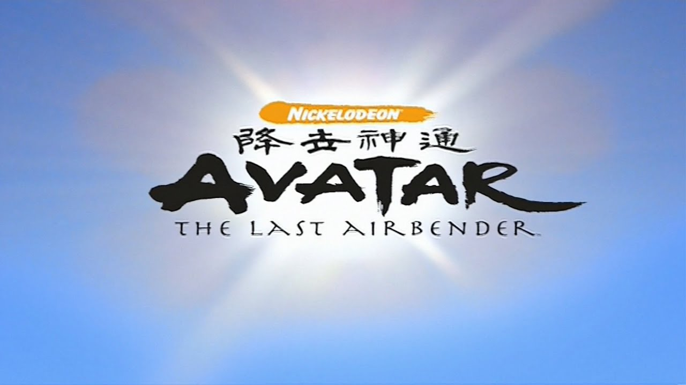
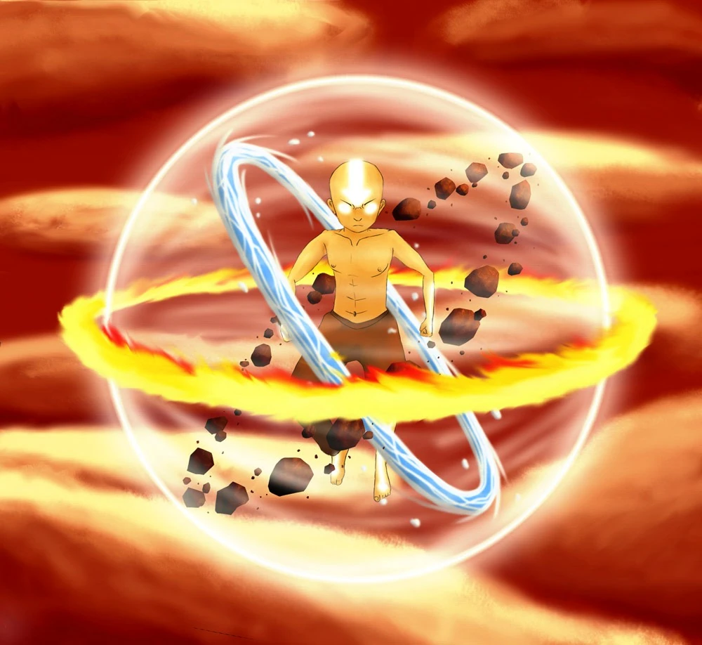
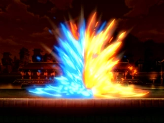
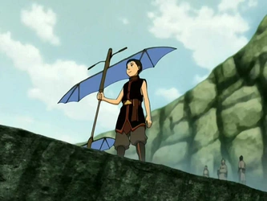

# 🌊 Avatar: The Last Airbender 🪨

### *Water. Earth. Fire. Air. Long ago, the four nations lived together in harmony...*

*“Only the Avatar, master of all four elements, could stop them. But when the world needed him most, he vanished.”*

---

## 📖 Table of Contents

- [The Storyline](#-the-storyline)
- [Watch Order](#-watch-order)
- [Iconic Scenes & Visuals](#-iconic-scenes--visuals)
- [Comics & Graphic Novels](#-comics--graphic-novels)
- [Novels — Chronicles of the Avatar](#-novels--chronicles-of-the-avatar)
- [Other Books & Media](#-other-books--media)
- [Image Credits & Attribution](#-image-credits--attribution)

---

## 📜 The Storyline

Avatar: The Last Airbender takes place in a world divided into four nations: the Water Tribes, the Earth Kingdom, the Fire Nation, and the Air Nomads. Within each nation, certain individuals are born with the ability to **bend** — to telekinetically manipulate their native element through martial arts. The only person who can bend all four elements is the **Avatar**, the bridge between the physical and spirit worlds and the maintainer of global harmony.

> **The core premise:**  
> “The series follows the journey of twelve-year-old Aang, the current Avatar and last survivor of his nation, the Air Nomads, along with his friends Katara, Sokka, and Toph, as they strive to end the Fire Nation’s war against the other nations and defeat Fire Lord Ozai before he conquers the world.”

### The Inciting Incident

One hundred years before the start of the series, a young Aang learns he is the new Avatar. Afraid of the immense responsibility, he flees from his home and is forced into the ocean by a storm, where he enters the Avatar State and encases himself and his flying bison, Appa, in a sphere of ice.

### The Awakening

A century later, Katara and Sokka of the Southern Water Tribe discover and awaken Aang. He quickly learns that the Fire Nation has ravaged the world through decades of war. Faced with the genocide of his people and the suffering of the world, Aang realizes he must fulfill his destiny: master all four elements and restore balance by defeating Fire Lord Ozai.

### The Journey

Across three seasons — **Book One: Water**, **Book Two: Earth**, and **Book Three: Fire** — Aang and his growing found family travel the world. They seek masters to teach Aang waterbending, earthbending, and firebending while evading the exiled Fire Nation prince, Zuko, and his uncle Iroh, who initially seek to capture Aang to restore Zuko’s honor. The finale sees Aang confront Ozai during **Sozin’s Comet**, using energybending to strip the Fire Lord of his power without taking his life — honoring his pacifist beliefs while saving the world.

---

## 📺 Watch Order

The essential viewing order is straightforward: the animated series and films form the chronological and release-order backbone of the franchise.

### 1. Avatar: The Last Airbender (2005–2008) — *Essential*

| Book | Title | Episodes | Key Arc |
|------|-------|----------|---------|
| **Book 1** | **Water** | 20 | Aang awakens, the Gaang forms, the journey north begins. |
| **Book 2** | **Earth** | 20 | The world deepens, Toph joins, and the franchise’s most devastating finale lands. |
| **Book 3** | **Fire** | 21 | Zuko’s redemption and the *Sozin’s Comet* finale pay off everything. |

### 2. The Legend of Korra (2012–2014) — *Essential*

Set **70 years later** in a modern, industrial world, following the brash new Avatar, Korra.

| Book | Title | Episodes |
|------|-------|----------|
| **Book 1** | **Air** | 12 |
| **Book 2** | **Spirits** | 14 |
| **Book 3** | **Change** | 13 |
| **Book 4** | **Balance** | 13 |

### 3. Avatar: Seven Havens (2026–) — *Latest Series*

Set **225 years after *The Legend of Korra***, this new series introduces a post-apocalyptic era where the Avatar is feared rather than revered.

| Book | Title | Episodes | Status |
|------|-------|----------|--------|
| **Book 1** | **Seven Havens** | 13 | Premiered Oct 9, 2026 |
| **Book 2** | **TBA** | 13 | Renewed |
| **Book 3** | **TBA** | TBA | Renewed (future adaptation) |
| **Book 4** | **TBA** | TBA | Renewed (future adaptation) |

> **New Avatar, New Era:** The series follows **Pavi**, a young Earthbender who discovers she is the Avatar, only to learn that the world blames the Avatar for a catastrophic event. She must team up with her long-lost twin sister, **Nisha**, to uncover their origins and save the last remnants of civilization, the **Seven Havens**.

### Recommended Full Franchise Order (Optional Expansions)

The community consensus for the “full, optimal experience” is:

1. **Avatar: The Last Airbender** — Books 1–3
2. *(Optional)* **ATLA Comics** — *The Promise* onward
3. **The Legend of Korra** — Books 1–4
4. *(Optional)* **Korra Comics** — *Turf Wars* onward
5. *(Optional)* **Novels** — *The Rise of Kyoshi*, *The Shadow of Kyoshi*, *The Dawn of Yangchen*, *The Legacy of Yangchen*
6. **The Legend of Aang: The Last Airbender** (2026 film)
7. **Avatar: Seven Havens** — Books 1–4 (Ongoing)

> **Chronological note:** The prequel novels (Kyoshi and Yangchen) are set thousands of years before the shows. Watch both series first for the richest experience.

---

## 🖼️ Iconic Scenes & Visuals

Below are some of the most memorable moments from the original series, with placeholders for scene images. *(Replace the `src` URLs with your own hosted images in the repo.)*

### Aang in the Avatar State

> **The moment:** Aang’s eyes and arrow tattoos radiate golden light as he channels the combined power of all past Avatars. This state signals immense spiritual power and appears in pivotal battles throughout the series.

*Aang in the Avatar State — eyes and tattoos glowing with cosmic energy.*

---

### Zuko and Azula’s Final Agni Kai

> **The moment:** The emotional climax of the series — brother and sister duel beneath a sky darkened by Sozin’s Comet. The scene is widely regarded as one of the most beautifully animated and tragic sequences in the franchise.

*The final Agni Kai — fire and lightning against a falling sky.*

---

### Aang Gliding on His Glider

> **The moment:** Aang mid-glide with his signature orange glider, arms gripping the frame, legs trailing behind — the quintessential image of freedom and airbending joy.

*Aang and his glider — the last airbender in flight.*

---

### Iroh’s Memorial for Lu Ten

> **The moment:** On a hill in Ba Sing Se, Iroh sings “Leaves from the Vine” in memory of his son, Lu Ten. A quiet, devastating character moment that redefined the show’s emotional depth.

*“Leaves from the vine, falling so slow...”*

---

### Energybending — The Final Confrontation

> **The moment:** In the final episode, Aang uses energybending to strip Ozai of his firebending, choosing mercy over execution and fulfilling his role as the Avatar in a way no one expected.

*Energybending — the Avatar’s ultimate act of balance.*

---

## 📚 Comics & Graphic Novels

The comics are **canon** and produced by Dark Horse Comics, with heavy involvement from original creators Michael Dante DiMartino and Bryan Konietzko. They serve as the most direct continuation of the original series’ story.

### Main Trilogies (Read in This Order)

| # | Title | Release | Focus |
|---|-------|---------|-------|
| 1 | **The Promise** | 2012 | Post-war reconstruction; Aang and Zuko grapple with Fire Nation colonies and Aang’s promise to kill Zuko if he turns tyrannical. |
| 2 | **The Search** | 2013 | Zuko, Azula, and Team Avatar search for Ursa, Zuko’s long-lost mother. |
| 3 | **The Rift** | 2014 | Aang tries to honor Air Nomad traditions while Toph confronts her father’s destructive mining operation. |
| 4 | **Smoke and Shadow** | 2015 | The New Ozai Society threatens Zuko’s rule; the Kemurikage spirits kidnap Fire Nation children. |
| 5 | **North and South** | 2016 | Katara and Sokka return to a radically changed Southern Water Tribe, facing a potential civil war. |
| 6 | **Imbalance** | 2018 | Tensions between benders and nonbenders reach a boiling point in a factory town built around *The Rift*’s industry. |

### Standalone Graphic Novels

| Title | Year | Summary |
|-------|------|---------|
| **Katara and the Pirate’s Silver** | 2020 | Katara separated from the Gaang, forced to survive with pirates during Book 2. |
| **Toph Beifong’s Metalbending Academy** | 2021 | A bored Toph finds new purpose through a secret underground bending tournament. |
| **Suki, Alone** | 2021 | Suki’s imprisonment at the Boiling Rock, paralleling “Zuko Alone.” |
| **Azula in the Spirit Temple** | 2023 | Azula confronts her past and shortcomings in a spirit temple after a failed insurrection. |
| **The Bounty Hunter and the Tea Brewer** | 2024 | Iroh and June team up in a fan-favorite reunion. |

### Short Story Collections

- **The Lost Adventures** (2011) — One-shot stories originally published in *Nickelodeon Magazine*, set between episodes of the show.
- **Team Avatar Tales** — A companion collection of short comics.

> **Reading order tip:** For a seamless post-series experience, read *The Promise* → *The Search* → *The Rift* → *Smoke and Shadow* → *North and South* → *Imbalance*, with the standalones slotting in wherever their internal chronologies fit.

---

## 📖 Novels — Chronicles of the Avatar

The **Chronicles of the Avatar** series, published by Amulet Books, explores the lives of Avatars from eras long before Aang.

| Title | Avatar | Duology |
|-------|--------|---------|
| **The Rise of Kyoshi** | Kyoshi | Book 1 |
| **The Shadow of Kyoshi** | Kyoshi | Book 2 |
| **The Dawn of Yangchen** | Yangchen | Book 1 |
| **The Legacy of Yangchen** | Yangchen | Book 2 |

> These are **young-adult novels** that delve deeper into the lore and politics of the Avatar world. They hit hardest after you already love the universe, making them ideal for older fans and completionists. A box set collecting all four novels (with an exclusive poster) was released in 2024.

---

## 📚 Other Books & Media

### Reference & Art Books
- **Avatar: The Last Airbender — The Art of the Animated Series** — Concept art, behind-the-scenes, and creator commentary.
- **The Lost Scrolls** series — In-universe lore books covering Water, Earth, Fire, and Air.

### The 2026 Animated Film
- **The Legend of Aang: The Last Airbender** — An upcoming animated film from Avatar Studios, set in the ATLA timeline and positioned after the original series and its comics.

### Avatar: Seven Havens (2026–Present)
- The latest animated series, set 225 years after *The Legend of Korra*. It introduces twin Avatars, Pavi and Nisha, in a post-apocalyptic world.
- Produced by Avatar Studios and Nickelodeon Animation Studio, with original creators Michael Dante DiMartino and Bryan Konietzko executive producing.
- Premiered on Paramount+ on October 9, 2026, with a 13-episode Book 1.
- Already renewed for Books 3 and 4.

### Live-Action
- **Netflix’s *Avatar: The Last Airbender*** (2024–) — A live-action reimagining. Best treated as a **companion** to the animated series rather than a replacement.

### Video Games
- The games are a **side path** and not required for the core story, but they offer additional ways to explore the Four Nations.

---

## 🖼️ Image Credits & Attribution

All images used in this README are **placeholders** and are intended to be replaced with actual screenshots or fan art in your repository. When adding real images:

- Use images from **official press kits**, **fair-use screenshots**, or **Creative Commons fan art**.
- Credit the original artists and link back to their sources.
- Respect Nickelodeon/Paramount’s intellectual property — this repository is a **fan project** and is not affiliated with or endorsed by the rights holders.

---

## 🤝 Contributing

Found a missing comic, a better reading order, or a broken image link? Contributions are welcome. Please open an issue or submit a pull request with clear sourcing.

---

### *“Sometimes life is like this dark tunnel. You can’t always see the light at the end of the tunnel, but if you just keep moving... you will come to a better place.”* — Uncle Iroh

**⭐ Star this repo if you’re a fan of the Four Nations ⭐**

